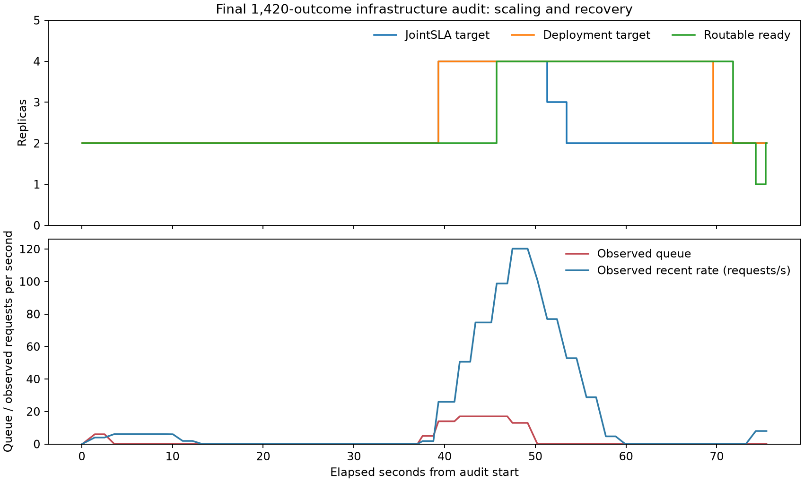
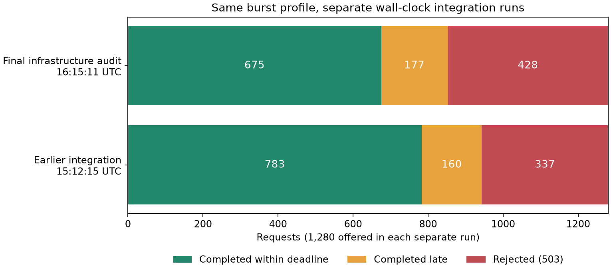
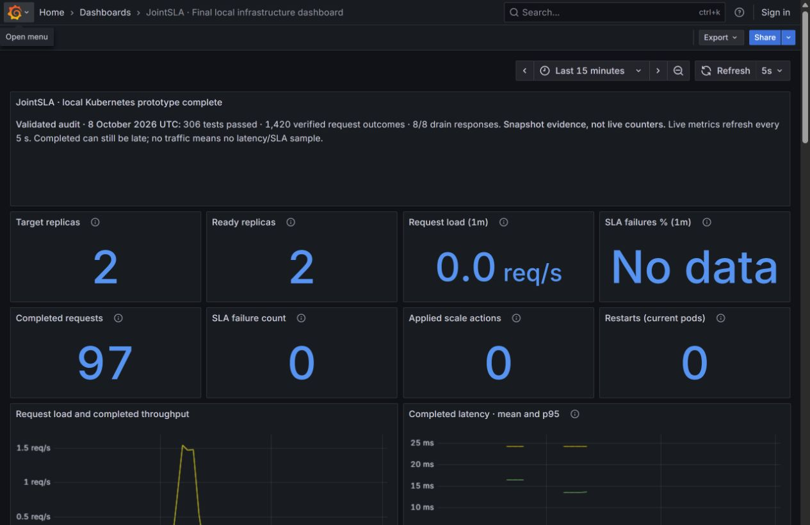

# JointSLA: final local infrastructure and experimental validation report

8 October 2026 · One physical host · One kind Kubernetes node · CPU inference.

**The bounded local JointSLA Kubernetes prototype is complete.** The original
infrastructure audit passed 306 tests and verified 1,420 request outcomes. The
final dashboard extension passes **310 tests**, including four new observability
regressions. Scaling, warm-up, draining, pod replacement, gateway crash/hang
recovery, monitoring persistence and reproducible deployment have evidence.
The burst SLA target of less than 15% has **not** been achieved. General production
readiness, multi-host availability and algorithmic performance superiority are
outside this completion claim.

## 1. What JointSLA does

JointSLA is an interpretable SLA-aware research orchestration method coupling
request routing with replica decisions. Routing uses observed queues, measured
service-cycle duration/variance and deadline headroom. Warm-headroom calculation
uses queued work, recent arrivals, cold-readiness allowance and deadline slack to
avoid insufficient ready capacity. The risk score is a proxy, not a calibrated
violation probability or a learned predictor.

The research simulator models the broader placement/scaling environment and
owns the frozen scientific experiments. This local runtime executes the existing
pretrained MobileNetV3-Large model in real CPU containers, and reuses the unchanged
`joint_routing.router.choose` and `joint_sla_v2.policy.required_warm` functions.
It adapts these functions to one inference Deployment; it does not port the full
simulator state machine or validate placement across five physical edge servers.
The infrastructure extension adds no new AI/ML component and changes no frozen
scientific source, configuration or result.

Research contribution and infrastructure contribution have distinct evidence:
the research explores joint routing/scaling under SLA and cold-start constraints;
the prototype demonstrates real telemetry, Kubernetes actuation and operational
failure handling for the existing mechanism. This report makes no claim of
literature-level novelty solely from Kubernetes integration.

## 2. Architecture and Kubernetes setup

```text
Client -> 127.0.0.1:8091 -> gateway + JointSLA controller (one pod)
                            | observed queues / cycles / recent arrivals
                            | existing routing + warm-headroom functions
                            +-> Ready, non-terminating inference pods (2–4 normally)
                            |   real pretrained MobileNetV3-Large / CPU
                            +-> inference Deployment scale API (bounded 1–4)
                                Kubernetes schedules / replaces pods

Serving metrics + read-only pod snapshots -> Prometheus PVC -> Grafana PVC
                                               :9091            :3001
Frozen simulator / research results remain separate from live runtime evidence.
```

Cluster `jointsla-prototype`, namespace `jointsla-prototype`, Kubernetes 1.36.4,
kind 0.33.0; Docker Desktop Linux amd64 on Windows. The kind node image, Python
base and monitoring images are digest-pinned. Application tags identify loaded
image IDs. Python and CPU PyTorch dependencies are pinned. Synthetic 224×224
benchmark tensors exercise real pretrained inference; this is not an accuracy
study on real-world images. CUDA/GPU operation is not validated in this cluster.

The controller has namespace-scoped pod read/list access and get/patch access
only to the named inference Deployment's scale subresource. It cannot read
Secrets, delete pods or scale the gateway. The new observer uses these existing
read permissions, polls separately every 5 s, and never participates in policy
decisions. API errors mark its health false and retain a visibly stale snapshot.
Scrapes use the cache and cannot block on Kubernetes API calls.

Each Deployment runs non-root with dropped capabilities, RuntimeDefault seccomp,
a read-only root filesystem and no privilege escalation. Only the gateway mounts
a service-account token. Local host ports bind to loopback. Grafana anonymous
access is Viewer-only and its random admin credential is stored outside Git.

## 3. Scaling and recovery flow

1. Every 2 s the gateway discovers ready, non-terminating pods and reads service
   state. A 10 s trailing arrival window supplies observed request rate.
2. The unchanged warm-headroom function calculates a bounded replica target;
   routing selects eligible replicas using the existing SLA/queue risk ordering.
3. A 30 s actuation cooldown limits changes. Scale patches include resourceVersion;
   conflicts fail safely and reconciliation retries on the next control step.
4. New pods load weights and run model warm-up before opening their HTTP listener.
   Readiness must succeed before the gateway includes them in routing.
5. Scale-in withdraws terminating pods. SIGTERM stops admission, drains admitted
   work and response writes, and exits within the bounded grace period.
6. A deleted inference pod is replaced by its Deployment. Failed/draining
   endpoints are withdrawn; previously forwarded requests are not automatically
   replayed. A gateway crash or hang triggers Kubernetes restart/recovery.

The recorded audit shows **2 → 4 → 2** target reconciliation, new replicas serving
traffic, and return to the Gold warm floor of two. The earlier bootstrap run also
shows **1 → 2**. This is actual scaling, not a simulated replica counter.



## 4. Probes, limits, warm-up and draining

| Component | Startup / readiness / liveness endpoints | CPU request / limit | RAM request / limit |
|---|---|---:|---:|
| Inference | `/live` / `/ready` / `/live` | 500m / 1 core | 1 / 2 GiB |
| Gateway | `/live` / `/ready` / `/live` | 100m / 1 core | 256 / 512 MiB |
| Prometheus | `/-/healthy` / `/-/ready` / `/-/healthy` | 100m / 500m | 128 / 512 MiB |
| Grafana | `/api/health` for all three | 100m / 500m | 128 / 512 MiB |

Serving startup probes allow 150 failures at 2 s intervals. Serving readiness
checks every 2 s with one failure sufficient; liveness checks every 10 s with
three failures. Gateway readiness requires a fresh controller snapshot and a
ready backend; a dependency outage alone does not fail its liveness. A stalled
control loop or inference execution stuck beyond 60 s does.

Both serving pods have 75 s termination grace, a 2 s preStop propagation delay
and a 60 s bounded drain. Admission/readiness withdrawal is atomic; draining
waits for application work **and the full HTTP response write**. The inference
worker is serial with eight waiting slots plus one active request. HTTP handlers
are bounded at 128, with eight bounded auxiliary handlers keeping health/metrics
and rejection responses accessible during saturation. Body/response sizes and
socket waits are bounded. Excess auxiliary saturation can still close a socket.

Inference PDB minAvailable=1 applies to voluntary evictions; it does not guarantee
availability during direct deletion, Deployment scale-in or node loss. The
gateway uses Recreate updates to prevent two concurrent scaling writers; this
single-controller design has a brief rollout availability gap.

## 5. The 1,420 verified request outcomes

Final traffic audit run: **20261008T161511 UTC**. The separate infrastructure
validator ran at **20261008T161627 UTC**. These are controlled integration checks,
not new paired Monte Carlo scientific experiments.

| Phase | Offered | Completed | SLA failures | Rejected | Mean completed latency | Exact completed p95 |
|---|---:|---:|---:|---:|---:|---:|
| Baseline, seed 11 | 60 | 60 | 0.00% | 0.00% | 124.15 ms | 188.23 ms |
| Burst, seed 23 | 1,280 | 852 | 47.27% | 33.44% | 204.57 ms | 307.12 ms |
| Pod-deletion recovery, seed 31 | 80 | 80 | 0.00% | 0.00% | 29.93 ms | 41.47 ms |

Every exported request ID, deadline, completion flag, SLA flag and summary was
checked. All 1,420 client outcomes are retained in
[request_outcomes.csv](prototype/kubernetes/evidence/infrastructure/request_outcomes.csv).
The three cohorts had zero transport errors. Completed latency excludes failed
and rejected requests. SLA rate includes **late completions plus every rejected
or failed request**, divided by all offered requests. Completion is successful
execution and does not necessarily mean SLA satisfaction.

Burst pacing was 120 requests/s with client concurrency 32. Gold/Silver/Bronze
deadlines were 200/400/800 ms. The model service uses FIFO admission, not a
tier-priority queue. Final burst tier breach rates were Gold **73.77%**, Silver
**39.58%**, Bronze **28.40%**. These are deadline-specific observations; they are
not evidence of Gold service protection under overload.

## 6. Why 38.83% and 47.27% are both present

They are **two different runs of the same paced burst protocol**, not two
percentages for the same dataset and not two independent algorithm variants.

| Measurement | Earlier integration: 15:12:15 UTC | Final audit: 16:15:11 UTC |
|---|---:|---:|
| Run ID | `20261008T151215` | `20261008T161511` |
| Offered requests | 1,280 | 1,280 |
| Completed within deadline | 783 | 675 |
| Completed late | 160 | 177 |
| Rejected with HTTP 503 | 337 | 428 |
| Other failed burst requests | 0 | 0 |
| SLA failures | 160 + 337 = **497** | 177 + 428 = **605** |
| SLA failure rate | 497 / 1,280 = **38.828125%** | 605 / 1,280 = **47.265625%** |
| Mean completed client latency | 168.84 ms | 204.57 ms |
| Exact completed client p95 | 308.85 ms | 307.12 ms |

Both used seed 23, the same offered tensor seeds/tiers/deadlines, 120 requests/s,
1,280 requests and concurrency 32, on one host with maximum four replicas.
The earlier run began with bootstrap warm repair (1 → 2); the final run already
had two ready replicas. The intervening infrastructure audit hardened transport,
shutdown, resource/security enforcement and monitoring. The policy functions
were not redesigned. Starting state, scheduling, contention and wall-clock
model execution can differ even with identical generated request seeds.

The observed increase is **8.4375 percentage points**: 91 more rejections and
17 more late completions. There are no replicated, isolated before/after trials
establishing which factor caused it. Do not claim that the hardening itself
caused the increase or that one percentage supersedes the other's original data.
Use **47.27% for the final infrastructure audit** and retain **38.83% as the earlier
integration observation**. Neither meets the <15% target. The earlier separate
unpaced pilot is excluded from this comparison.



Exact reconstruction and source hashes:
[comparison CSV](prototype/kubernetes/evidence/final_dashboard/burst_comparison.csv),
[tier CSV](prototype/kubernetes/evidence/final_dashboard/burst_comparison_by_tier.csv),
[verification manifest](prototype/kubernetes/evidence/final_dashboard/comparison_verification.json).
The compact earlier burst CSV is retained alongside them for reproducibility.

## 7. Tests and operational evidence

| Verified scenario | Evidence/result |
|---|---|
| Original test suite plus infrastructure regressions | **306 passed**: 285 existing + 21 infrastructure tests |
| Final dashboard extension | **310 passed**: the 306 suite + 4 new observer/dashboard regressions |
| Queued-work SIGTERM | 8/8 complete JSON inference responses, with withdrawal/drain |
| Cold replacement | Non-ready replacement observed and excluded from routing |
| Inference pod deletion | Replacement observed; 80/80 requests completed in final recovery cohort |
| Gateway SIGKILL | Actual restartCount increase and serving recovery |
| Gateway SIGSTOP | GatewayUnavailable alert observed; liveness restarted the process |
| API failure / scale conflict | Next-step recovery, bounded calls and no blind replay covered by tests |
| Least-privilege RBAC | Own scale allowed; other scale, secrets and pod deletion denied |
| Monitoring restarts | Historical Prometheus samples and Grafana annotation persisted |
| Empty cluster + redeploy | Separate lab bootstrapped; reapply preserved replica count and pod UIDs |
| Frozen integrity | 12 frozen sources/configs, 20,769 historical hashes and 439 additional hashes unchanged; 24,364 result-file sizes/mtimes unchanged at audit |
| Read-only observer | Cached scrapes, API outage/staleness/recovery, UID replacement and terminating readiness covered |

The audit evidence remains unchanged in
[evidence/infrastructure](prototype/kubernetes/evidence/infrastructure/).
[INFRASTRUCTURE_VALIDATION.md](INFRASTRUCTURE_VALIDATION.md) is the detailed dated
audit record (its 12-panel dashboard description refers to that historical
revision). The final dashboard has **28 panels**. The extension's new live checks
are stored separately, so demonstration traffic is never merged into the 1,420
audited outcomes or frozen paper experiments.

## 8. Final dashboard and observability definitions

[Open final Grafana dashboard](http://127.0.0.1:3001/d/jointsla-runtime).
[Prometheus alerts](http://127.0.0.1:9091/alerts).

The top dated audit card displays **306 tests passed / 1,420 verified outcomes**.
The next live cards show JointSLA target replicas, routable ready replicas, offered
load and SLA failure rate over the last minute. Exact process-lifetime cards show
completed requests, SLA failures and applied scaling actions, followed by current
pod UID restart counts. Request graphs, mean/p95 latency, tier outcomes, queues,
target-versus-ready recovery, action outcomes, pod state/reasons, CPU/RAM, VRAM,
controller timing, freshness, health, saturation and alerts provide detail.
The bottom table preserves both burst experiments as dated static evidence.



The captured 97 completions include the deployment smoke request plus the 96
demo requests. The idle live rate is zero and the idle SLA window has No data;
the historical 1,420-outcome card remains a separate audit snapshot.

Metric boundaries:

- Live rates use gateway application metrics and a trailing 1 min window. SLA
  failure denominator is finalized application outcomes; this avoids dividing
  newly offered but still-running work into a finalized failure numerator.
  During request completion, live windows need not equal all-offered client CSV
  cohorts. In idle windows latency/SLA have no sample, shown as No data.
- Mean latency is total duration / completion count. Live p95 is an aggregated
  histogram estimate; exported CSV p95 uses exact recorded client durations,
  including network and client scheduling waits. These are different measures.
  See [Prometheus histogram guidance](https://prometheus.io/docs/practices/histograms/).
- Headline request/action totals are exact counters since the current gateway
  process started, reset on restart, and do not follow the time-range selector.
  The action/rejection graphs use extrapolated Prometheus `increase`; those are
  estimates, not an exact CSV ledger. Scrape gaps can miss short-lived events.
- Kubernetes restartCount is a per-pod-UID container state. Pod replacement and
  scale-in are not labeled as crashes. Readiness/terminating timelines and UID
  changes show replacement/warm-up; last termination reason is historical state,
  not a new failure counter. See [Kubernetes pod lifecycle](https://kubernetes.io/docs/concepts/workloads/pods/pod-lifecycle/).
- CPU and RAM are **serving-process** CPU cores and resident bytes, not full
  cgroup/node utilization. Actual allocated CUDA VRAM is zero in CPU mode.
- JointSLA applied actions are successful scale patches; failed actions are
  reconciliation errors. Kubernetes autonomous replacements are separate.

Prometheus scrapes every 2 s and evaluates four infrastructure alerts every 5 s:
gateway unavailable, stale telemetry, no ready inference and reconciliation
failure. Retention is bounded at 7 days / 1500 MB in a 2 GiB PVC; Grafana has a
1 GiB PVC. No external notification receiver is configured. Pod snapshots poll
every 5 s using the existing controller read permissions.

## 9. Reproduce and inspect

From the repository root, with Docker Desktop Linux containers, kubectl,
Compose v2 and Python 3.12 available:

```powershell
powershell -NoProfile -ExecutionPolicy Bypass -File prototype/kubernetes/deploy.ps1
# Full infrastructure/traffic validation, deliberately interrupts local pods:
powershell -NoProfile -ExecutionPolicy Bypass -File prototype/kubernetes/deploy.ps1 -Validate
.venv/Scripts/python.exe -m pytest -q
.venv/Scripts/python.exe -m prototype.kubernetes.report_final
# Optional small live dashboard demo (separate from the historical audit):
.venv/Scripts/python.exe -m prototype.load --url http://127.0.0.1:8091 --requests 96 --concurrency 4 --rate-rps 8 --seed 41 --output prototype/.cache/final_dashboard_demo
.venv/Scripts/python.exe -m prototype.kubernetes.validate_dashboard
```

The report reconstruction uses curated CSVs; it does not rerun experiments.
One-command deployment creates/reuses the owned kind cluster, builds and loads
images, renders monitoring, waits for rollout and performs real-inference smoke
checks. It preserves controller-owned replica counts and monitoring PVCs.
`-SkipBuild` reuses existing images. Dedicated kubeconfig/context are explicit:

```powershell
kubectl --kubeconfig .cache/kubernetes/config --context kind-jointsla-prototype -n jointsla-prototype get pods
```

Research simulator code, prototype serving code and experiment/evidence runners
remain separate. Deployment does not change the global kubeconfig or publish
images. Version/configuration reproduction does not promise bit-identical
wall-clock latencies.

## 10. Limitations and conclusion

The local prototype is **complete within its stated boundary**: real existing
inference, unchanged JointSLA policy reuse, actual Kubernetes scaling, operational
recovery, bounded serving/draining, persisted observability and reproducible
deployment are implemented and validated. The final report/dashboard provide
an inspectable link between code, live state and recorded outcomes.

This does not certify internet-facing or high-availability production. One
gateway and one physical host have restart/rollout/host-loss availability gaps.
Runtime arrival history/cooldown reset on gateway restart. PVC data survives pod
restarts, not kind node/cluster loss. Forced kill, OOM or client disconnect cannot
guarantee response delivery or exactly-once execution. CPU-only validation does
not establish multi-service/multi-edge/GPU scheduling performance.

An external production target still needs authenticated TLS ingress, enforced
network isolation, durable backups/restore drills, secret rotation, vulnerability
and provenance verification, external alerts, and capacity/load acceptance.
Most decisively, the final overload burst has **47.27% SLA failures**, so adequate
capacity and the <15% performance goal remain open research/deployment questions.
The complete local infrastructure is a foundation for those controlled future
experiments; the frozen paper results and their scientific claims are preserved.

The comparative research gaps are tracked separately in the
[Kubernetes research evaluation protocol](prototype/kubernetes/RESEARCH_EVALUATION_PROTOCOL.md):
matched static/reactive/native HPA baselines, 30 paired trial blocks, detailed
failure traces and routing/scaling ablations. The isolated six-arm pilot has passed, all 330 tests pass, and the main
180-trial experiment has completed under the v2 manifest; the aborted v1 attempt
remains excluded and preserved. Execution progress
and completion are recorded in `prototype/.cache/kubernetes_comparison_v2/`;
comparative conclusions require all 30 blocks and independent reconstruction.
See also the [prior-work scope](prototype/kubernetes/COMPARATIVE_NOVELTY_SCOPE.md). A [descriptive failure audit](prototype/kubernetes/evidence/research_gap_audit/failure_audit.json)
establishes that all 177 late completions in the final burst were Gold and all
428 rejected rows were routed backend 503s. Their exact rejection reasons were
not retained, so queue saturation is not certified as the cause of every 503.


## User-requested execution pause

The comparative v2 run was paused before the block-0 joint_sq burst and resumed
on the same processes. See the [pause disclosure](prototype/kubernetes/evidence/comparison_v2/USER_PAUSE_NOTE.md).
Raw preparation/wall-time metrics include this pause and are not unadjusted
runner speed evidence. No completed trial or request outcome was removed.


## Completed matched Kubernetes evaluation v2

The new six-arm comparison completed 30 paired blocks / 180 trials and
independently reconstructed 230,400 offered outcomes. Historical 38.83%
and 47.27% runs and the aborted v1 attempt are excluded. See the
[comparative report](prototype/kubernetes/evidence/comparison_v2/COMPARATIVE_REPORT.md),
[run values](prototype/kubernetes/evidence/comparison_v2/runs.csv), and
[paired effects](prototype/kubernetes/evidence/comparison_v2/paired_comparisons.csv).
The comparative report, rather than a live dashboard lifetime counter,
defines the statistical result and limitations. Protected source/report
hashes and historical result file metadata were checked unchanged.
