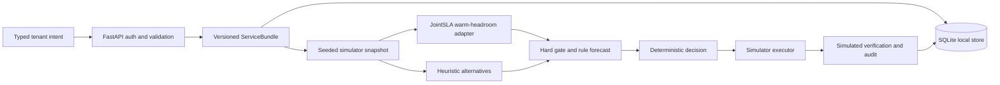
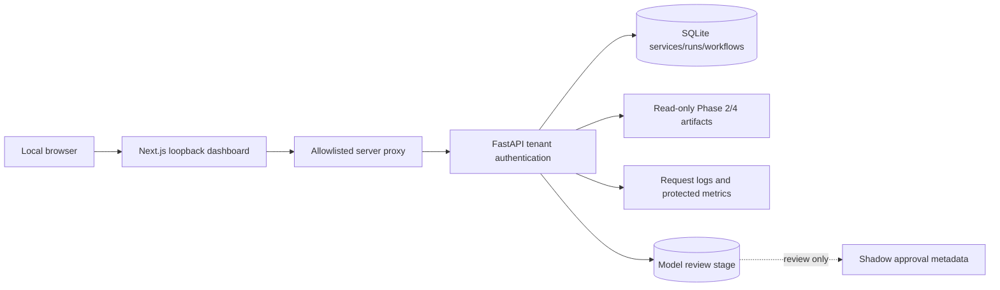

# Sovereign-MaaS architecture

The Phase 1 modular monolith is a local simulator. The API authenticates a configured tenant token, validates a typed intent, stores a versioned bundle, generates a seeded observation, proposes actions, applies a deterministic policy gate, executes the selected action in memory, verifies simulated SLO compliance, and persists the audit record. No external cluster or model service is contacted.

`sovereign_maas/domain.py` owns strict versioned API contracts. `simulation.py` owns seeded topology, rule forecasts and execution. `decision.py` owns candidate provenance, hard gates, recoverability slack, ranking and rejection reasons. `store.py` owns tenant-scoped persistence and idempotency. `api.py` owns authentication and HTTP boundaries. Existing JointSLA modules are imported, not altered.

Future boundaries: telemetry and prediction adapters; validated `joint_sla_v2.policy.actions` translation; optional LLM/Jev advisory; PostgreSQL repository; separately authorized Kubernetes adapter. All future proposals still pass the deterministic policy gate.

## Phase 2 prediction path

`research_data.py` generates one initially healthy episode per frozen seed/scenario, with future first-breach and action counterfactual labels. `research_models.py` fits NumPy logistic breach and discrete hazard models, a linear q90 TTR model and a PostSLA classifier, storing checked JSON coefficients. `TrainedForecastProvider` is opt-in via `SOVEREIGN_MODEL_DIR`; it returns probabilities, q10 TTV, per-action q90 TTR, PostSLA probabilities, lineage, expiry and OOD status. `decision.py` independently enforces authorization/capacity/residency, recovery slack and freshness. An unusable forecast selects no-op with an explicit reason. With no configured predictor the Phase 1 rule path remains available.

## Phase 3 intent and approval path

An offline parser requires all seven intent fields explicitly in English/Greek labeled text. An optional OpenAI Responses adapter requests a strict JSON schema, then the same Pydantic and source-grounding checks apply. Neither parser can set tenant identity. A small versioned local knowledge base is searched only after tenant/classification filtering; hits carry source ID and version and are never executed as instructions. LangGraph checkpoints a bounded parse → plan → approval interrupt → execute path in a sibling SQLite database. Separate approver credentials resume it. The only effect is the existing idempotent simulator. Business records and tenant ownership remain in the main SQLite store; a graph checkpoint is not an authorization decision.

## Phase 4 advisory judgment path

An opt-in `JudgmentProvider` consumes a strictly allowlisted, bounded numeric state and the already proposed candidates. `DisabledJudgmentProvider` returns an explicit disabled record. `FixtureJudgmentProvider` yields deterministic simulated proxy answers for offline tests. `TypeSafeJevProvider` sends one mixed typed-question request to the documented System One endpoint only for an explicitly allowlisted tenant. All response fields are validated before an advisory record is exposed. An unavailable or low-confidence judgment cannot alter the decision engine's existing deterministic feasibility, residency, quality, approval or idempotency gates. Separate OFF/fixture ON comparisons on the frozen synthetic snapshots evaluate integration behavior, not live Jev accuracy.

## Phase 5 local operations view

The Next.js App Router dashboard in `apps/web` uses a narrow server route handler as its API client boundary. The browser never receives the configured tenant or approver token; the server forwards only allowlisted paths to FastAPI. This is a **loopback-only single-tenant local demo**, with no human login or production session management. Publishing it on a shared network would grant every visitor that configured tenant's capabilities. The UI has explicit loading, empty and error states, and shows only persisted simulated telemetry and frozen research metrics. The backend exposes tenant-filtered bounded lists; the UI does not infer a global total from a page of 50.

`observability.py` logs route templates, status, duration and a request correlation ID without body, token, tenant or object IDs. `/metrics` requires a separate scrape token and emits bounded-cardinality Prometheus text counters and histograms. There is no OTLP exporter or distributed trace collector. `/v1/monitoring` reports recent simulation coverage and SLO rate, but returns `NOT_EVALUATED` for drift because no live labeled stream or approved baseline exists. Schema v3 adds model review metadata; promotion records `APPROVED_SHADOW` for the already configured and validated artifact and **does not change the runtime predictor**. Model stage is platform-level local metadata, visible to configured tenants.

## Phase 6 safe cluster preview boundary

`kubernetes.py` separates a deterministic `SIMULATED_PLAN` from an optional Kubernetes server dry-run. `plan_scale` accepts only a persisted-like service/run pair and a trusted `DeploymentBinding`, rechecks the selected scale candidate, tenant, freshness, allowed action, placement and simulated verification, and emits an original/canary/target/rollback replica plan. `simulate_canary` exercises verification and rollback in memory with explicitly simulated observations. It performs no Kubernetes I/O.

`KubernetesDryRunAdapter` uses a fixed HTTPS API origin, bearer token and CA bundle supplied by an operator. It asks SelfSubjectAccessReview for deployment read and scale read/update, fetches the named Deployment and Scale, checks owner labels, namespace, region selector, UID, resourceVersion, current replica count and container resource shape, then sends only `PUT .../scale?dryRun=All&fieldValidation=Strict` for canary and target. The receipt states `persisted=false` and scheduler capacity `NOT_VERIFIED`. There is no cluster write/commit path; a future live actuator needs a separate approval, concurrency check, canary observation source and compensation contract. The optional HAMi reader fetches only a configured `/metrics` URL, filters configured node names and returns host-level GPU utilization and memory usage with scrape provenance. These metrics are not service-level outcomes and do not gate actions.

## Phase 7 offline policy research boundary

`research_phase7.py` loads the frozen Phase 2 counterfactual replay through its checksum-verifying loader. It constructs current-state snapshots under a fixed synthetic Gold/eu-gr/max-two-replicas profile, calls the existing JointSLA-backed deterministic policy, and masks scale unless that gate selects it. Migration is unavailable because the research profile has no authorized eu-de residency. The one-step policy-gradient contextual bandit trains only on train seeds 0–59; a bounded offline fixture proposes three reward weights, validation seeds 60–79 select a proposal, and reused test seeds 80–99 are evaluated once across five policy RNG seeds. No LLM, PPO/Dreamer, multi-step MDP, live cluster or runtime policy loading is part of this phase.

`results/phase7-v1` contains immutable model weights, metrics, reflection history and SHA-256 manifest. The preregistered statistical gate creates only an offline review candidate; the documented human review rejects promotion because it exactly matches the JointSLA gate with no incremental benefit. The normal API and decision engine never import the Phase 7 artifact.
