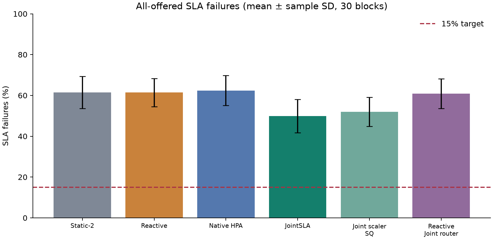
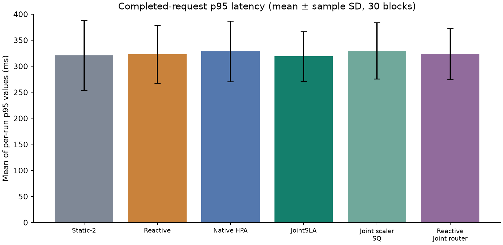
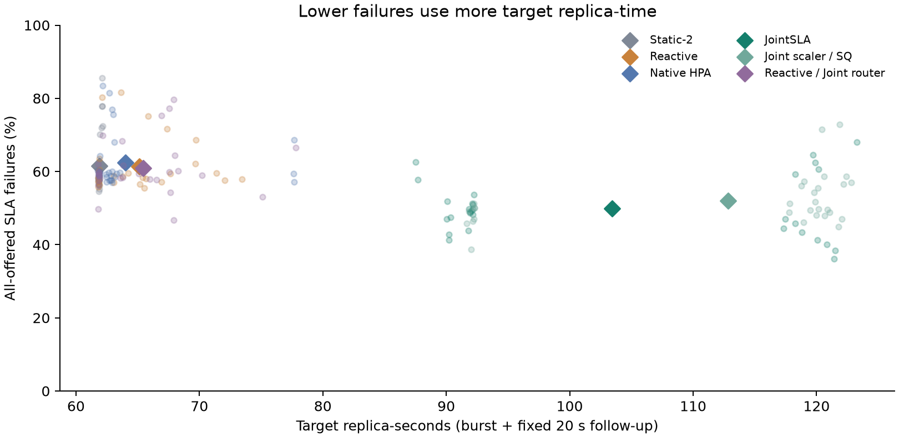
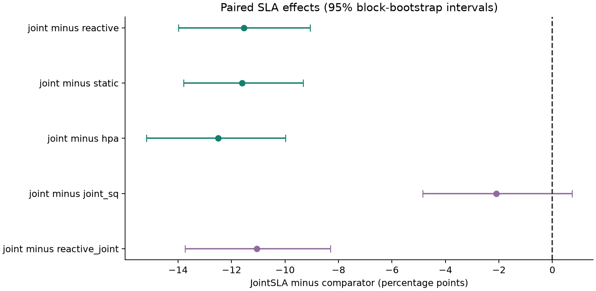

# JointSLA deadline aware routing and replica headroom for Kubernetes inference

Conference style research draft
Completed comparison v2   9 October 2026

## Abstract

Short inference bursts can fill queues before CPU-driven scaling provides ready replicas. We evaluate JointSLA, an interpretable combination of request deadline risk and causal warm-replica headroom, in a local Kubernetes prototype running real pretrained MobileNetV3-Large CPU inference. We compare six policies in 30 serial paired blocks using seeds 1001–1030. Each policy receives the same 1,280-request tape within a block at 120 requests/s with client concurrency 32. The completed design contains 180 trials and 230,400 offered outcomes. Gold, Silver and Bronze deadlines are 200, 400 and 800 ms. This Kubernetes workload is a deterministic paced burst of approximately 10.7 s. Seeds vary synthetic model tensors. It is distinct from the simulator’s stochastic traffic process. JointSLA reduces mean all-offered SLA failures to 49.89% from 61.43% for reactive scaling, 61.50% for static allocation and 62.39% for native HPA in the completed Kubernetes comparison v2. The primary paired difference is −11.54 percentage points, with a 95% block-bootstrap interval of [−13.98, −9.06] and Holm-corrected p = 3.725e−08. This improvement uses more target replica-seconds than the main baselines. JointSLA averages 103.45 versus 65.12 for reactive scaling, a 58.84% increase. The evidence does not establish greater resource efficiency. The failure target below 15% remains unmet. Routing ablation evidence is inconclusive. The contribution is a controlled empirical characterization and reproducible artifact, restricted to one model, one host and the registered burst regime.

## 1 Introduction

An orchestration policy must balance requests that complete within deadline against capacity kept available for bursts. CPU metrics can react after queues have already accumulated. A deadline-aware controller can reserve replica headroom and route using queue state, but favorable failure rates can also arise from keeping more capacity. A defensible evaluation must therefore measure both all-offered outcomes and replica-time.

We connect unchanged simulator-derived JointSLA functions to a real inference Deployment without adding a learned control component. The study contributes a six-arm repeated comparison with explicit failures, registered paired inference and rule ablations, plus resource-cost analysis. Prior literature already addresses SLA-driven provisioning and scheduling, so this work does not claim to invent that category.

# Related work and methodology

## 2 Related Work

InferLine combines profiling and pipeline provisioning with a fast response mechanism for latency objectives [1]. INFaaS selects model/hardware variants and scales resources under performance and accuracy requirements [2]. Clockwork emphasizes predictable inference execution and request-level objectives through controlled scheduling [3]. These systems motivate queue, readiness and capacity analysis. Our experiment focuses on an unchanged routing/headroom pair adapted to one Kubernetes CPU service. It does not reproduce those systems or compare against their published performance numbers.

Native HPA is an operational CPU baseline with asynchronous metrics and stabilization [4]. Our workload compares its actual configured timescale with the gateway loop. This focused related-work set is not exhaustive. Kubernetes integration alone is not a novelty claim.

## 3 Methodology

We compare six policies in 30 serial paired blocks using seeds 1001–1030. Each policy receives the same 1,280-request tape within a block at 120 requests/s with client concurrency 32. The completed design contains 180 trials and 230,400 offered outcomes. Gold, Silver and Bronze deadlines are 200, 400 and 800 ms. This Kubernetes workload is a deterministic paced burst of approximately 10.7 s. Seeds vary synthetic model tensors. It is distinct from the simulator’s stochastic traffic process.

SLA failure includes non-200 outcomes and completions after the tier deadline, using all offered requests as denominator. Completed-request latency is conditional and includes measured concurrency wait. Target and ready replica-seconds integrate from burst start through last response plus twenty seconds. Target cost includes pending capacity and is not energy, billing or actual CPU use. Ready-only cgroup counters are supplementary incomplete observations.

Each block is the unit of replication. We report means and sample standard deviations over 30 run-level measurements. Paired JointSLA-minus-comparator SLA differences use 10,000 percentile block-bootstrap resamples with seed 39108. Two-sided Wilcoxon tests use Pratt zero handling. Holm corrects the family of three core comparisons against reactive, static and HPA. The two registered mechanism comparisons remain exploratory with uncorrected p-values. The intervals are pointwise, not simultaneous coverage guarantees. Individual requests are not independent replications.

Resource-cost intervals in this final analysis are descriptive paired bootstrap intervals from the same trials, with seed 271830 and 10,000 resamples. They add no traffic, tuning or confirmatory p-value family.

# JointSLA design and experimental setup

## 4 JointSLA Design

Let q be queued requests, λ the recent arrival rate in requests/s, L the observed serial service-cycle duration, D the control deadline and R the cold-readiness allowance, all times in seconds. With h = max(D − L, 0), the frozen warm rule requests N = min(Nmax, max(floor, ceil(m × max(qL/h, (q + λR)L/(R + h))))). In this runtime the Gold multiplier m is 1.5, floor is two and Nmax is four. A nonpositive or unknown cycle requests the cap. If h is zero, zero demand keeps the floor and positive demand requests the cap. This is causal demand headroom, without a learned predictor.

The router estimates completion from observed waiting work, a busy service cycle and execution duration. It forms deadline slack and a variance-based risk proxy, then orders eligible candidates by risk, greater slack, lower estimated completion and deterministic replica identity. Nonpositive slack receives risk one. The proxy is not a calibrated probability or an SLA guarantee. The Kubernetes adapter supplies real ready-pod queues and service cycles. Simulator network/resource/migration terms are not physical multi-edge measurements in this adapter.

The runtime samples every two seconds, estimates arrivals over ten seconds and applies a thirty-second cooldown. Readiness gates traffic to cold and terminating pods. Control uses the global Gold deadline of 200 ms and a ten-second cold allowance. Routing retains each request’s deadline. Replica demand is bounded headroom rather than a guarantee of readiness before deadline.

## 5 Experimental Setup

| Arm | Scaling rule | Routing |
| --- | --- | --- |
| Static-2 | Fixed two warm replicas | Round-robin |
| Reactive | CPU >80% up or <20% down, one step | Shortest queue |
| Native HPA | CPU target 80%, native controller | Shortest queue |
| JointSLA | Frozen warm-headroom planner | Frozen SLA risk router |
| Joint scaler / SQ | Same JointSLA planner | Shortest queue |
| Reactive / Joint router | Same reactive rule | JointSLA router |

All arms use CPU MobileNetV3-Large IMAGENET1K_V2 and identical synthetic tensors, 500m/one-core CPU request/limit, 1/2 GiB RAM and a serial worker with eight waiting slots. The isolated kind lab runs Kubernetes 1.36.4 and metrics-server 0.9.0 on one Windows/Docker host. Bounds are two to four replicas. HPA retains native behavior defaults [4,5].

Before every arm we drain and stop the owned gateway, remove the benchmark HPA, return inference to two replicas and start a fresh policy process. We require two ready idle pods, no terminating pods and matching ready pod UIDs. Cycle histories reset, each backend receives eight identical direct preconditioning requests, and all arms settle for 35 s. The HPA arm also requires ScalingActive and valid CPU metrics. Actual scheduled, offered and dispatch timestamps remain in the traces. Every trial retains 20 s of follow-up after its last response.

Five randomized Latin cycles balance positions, with order seed 39107. Trials run serially. Sources, images and tapes freeze before main. Failed trials stop the runner and remain retained. Pilots, the stopped v1 attempt and historical infrastructure bursts are excluded. No selective reruns or outcome-dependent tuning contribute to v2.

# Results for all offered SLA failures

## 6 Results

JointSLA reduces mean all-offered SLA failures to 49.89% from 61.43% for reactive scaling, 61.50% for static allocation and 62.39% for native HPA in the completed Kubernetes comparison v2. The primary paired difference is −11.54 percentage points, with a 95% block-bootstrap interval of [−13.98, −9.06] and Holm-corrected p = 3.725e−08.

| Policy | SLA failure % | p95 ms | HTTP 503 % | Target replica s |
| --- | --- | --- | --- | --- |
| Static-2 / RR | 61.50 ± 7.85 | 320.99 ± 67.12 | 43.22 ± 8.03 | 61.90 ± 0.10 |
| Reactive / SQ | 61.43 ± 6.94 | 322.85 ± 55.60 | 43.16 ± 7.48 | 65.12 ± 3.39 |
| Native HPA / SQ | 62.39 ± 7.37 | 328.26 ± 58.23 | 43.76 ± 7.92 | 64.03 ± 4.65 |
| JointSLA | 49.89 ± 8.12 | 318.63 ± 47.74 | 33.98 ± 7.75 | 103.45 ± 14.60 |
| Joint scaler / SQ | 51.99 ± 7.14 | 329.54 ± 54.15 | 34.87 ± 6.74 | 112.84 ± 12.79 |
| Reactive / Joint router | 60.95 ± 7.27 | 323.45 ± 49.01 | 45.07 ± 7.34 | 65.44 ± 4.01 |

JointSLA minus static is −11.61 percentage points, with interval [−13.79, −9.33] and Holm p = 2.794e−08. JointSLA minus HPA is −12.50 points, with interval [−15.18, −9.99] and Holm p = 2.351e−06. All three core comparisons reject equality under the registered family. Pointwise intervals do not guarantee simultaneous coverage. The below-15% goal remains unmet.

These results establish a failure-rate improvement of the configured system in this burst regime. They do not establish superiority at equal replica-time, under sustained traffic or in independent physical deployments.

# Latency rejection and failure attribution

Completed p95 is 318.63 ± 47.74 ms for JointSLA and 322.85 ± 55.60 ms for reactive. Mean completed latency is 222.00 versus 268.14 ms. The p95 difference is small relative to variation. No confirmatory p95 superiority claim is made.

| Policy | HTTP 503 % | Queue-full count | Late count |
| --- | --- | --- | --- |
| Static-2 / RR | 43.22 ± 8.03 | 16596 | 7021 |
| Reactive / SQ | 43.16 ± 7.48 | 16575 | 7014 |
| Native HPA / SQ | 43.76 ± 7.92 | 16803 | 7155 |
| JointSLA | 33.98 ± 7.75 | 13050 | 6108 |

V2 rejected outcomes explicitly return queue-full. The classifier retains draining, no fresh endpoint, handler saturation, transport and unknown branches, but they have no observed main failures. These traces are more specific than the historical audit that discarded error details.

JointSLA’s 19,158 failures comprise 13,050 queue-full rejections and 6,108 late completions among 38,400 offered requests. Queue/execution timings and cgroup telemetry expose contention, but do not identify a causal fraction attributable to cold starts, throttling or queues. Completion-only latency can change with rejection selection and cannot replace the all-offered endpoint.

# Performance versus resource cost

This improvement uses more target replica-seconds than the main baselines. JointSLA averages 103.45 versus 65.12 for reactive scaling, a 58.84% increase. The evidence does not establish greater resource efficiency. The failure target below 15% remains unmet.

| Policy | Target replica s | Ready replica s | On-time requests |
| --- | --- | --- | --- |
| Static-2 / RR | 61.90 ± 0.10 | 61.90 ± 0.10 | 492.77 |
| Reactive / SQ | 65.12 ± 3.39 | 63.29 ± 2.42 | 493.70 |
| Native HPA / SQ | 64.03 ± 4.65 | 63.15 ± 3.76 | 481.40 |
| JointSLA | 103.45 ± 14.60 | 97.33 ± 12.32 | 641.40 |

JointSLA-minus-reactive additional target cost is 38.32 replica-seconds, with descriptive 95% interval [33.37, 43.38]. The 58.84% increase is a ratio of policy means. Extra cost versus static and HPA is 67.12% and 61.57%. These observations do not establish resource efficiency.

Ratios of mean target replica-seconds to mean on-time outcomes are 0.13 for reactive and 0.16 for JointSLA at two-decimal precision. Unrounded values remain in the tables. The descriptive marginal ratio is 0.25946 extra replica-seconds per additional on-time request. This window cannot characterize long-term cost. No matched-budget or static-four comparator was registered.

# Ablations and per tier findings

## 7 Ablations

JointSLA versus its shortest-queue routing ablation is −2.10 percentage points, with interval [−4.84, +0.73] and raw exploratory p = 0.158844. The interval crosses zero and does not establish a separate routing benefit. JointSLA versus reactive scaling with the Joint router is −11.05 points, with interval [−13.73, −8.30] and raw exploratory p = 3.147870e−07, consistent with a scaling/headroom contribution.

Rule replacement changes feedback and realized replica trajectories. These arms cannot uniquely decompose the gain. Joint scaler/shortest queue uses 112.84 target replica-seconds compared with JointSLA’s 103.45, while reactive/Joint router uses 65.44. These are exploratory observations.

| Policy | Gold failures % | Silver failures % | Bronze failures % |
| --- | --- | --- | --- |
| Static-2 / RR | 96.42 ± 1.41 | 43.79 ± 13.54 | 44.26 ± 9.43 |
| Reactive / SQ | 96.49 ± 1.32 | 44.99 ± 14.15 | 42.76 ± 7.75 |
| Native HPA / SQ | 96.64 ± 1.45 | 46.17 ± 13.51 | 44.33 ± 8.96 |
| JointSLA | 79.63 ± 12.84 | 35.94 ± 11.62 | 34.06 ± 8.44 |

JointSLA Gold fails 10,201 of 12,810 requests, or 79.63%, versus 96.49% for reactive. Silver and Bronze fail at 35.94% and 34.06%. FIFO admission, differing deadlines and shared resources prevent interpreting this as robust priority-tier protection.

# Limitations and conclusion

## 8 Limitations

This is one CPU model, one physical host, synthetic tensors and one virtual node. Physical GPU/VRAM, multi-edge placement, inference accuracy, a 6G data plane and multi-host availability remain unvalidated. Extra replicas share capacity. Background services and host activity remain. Thirty paired blocks do not represent thirty independent installations or a power certificate.

Native HPA keeps its asynchronous timings and stabilization. A 10.7 s burst can favor queue-aware control relative to CPU metric collection. Results cannot generalize to sustained traffic or tuned HPA. No matched-resource comparator isolates capacity from scheduling. The risk proxy is uncalibrated. Completed p95 excludes rejections and replica-time is not actual resource efficiency.

A user-requested pause interrupted preparation of the first block’s Joint-scaler/shortest-queue arm after its preconditioning calls and before its burst. The idle interval was 5,498.868465 s, approximately 91.65 minutes. No benchmark requests were offered during the pause. Resume checks verified unchanged sources, process identity and two ready idle backends. All 180 trials remain in the analysis. The extra idle period affects one exploratory arm and is a possible host-temperature/time-order limitation. Trial preparation and wall-time summaries include it and must not be interpreted as algorithm runtime.

The frozen held-out simulator models forty services on ten simulated nodes with a different state machine and CPU/GPU assumptions. Its overall latency/resource success criterion failed. Simulator percentages are not pooled with Kubernetes outcomes, and CPU results do not establish physical GPU behavior.

## 9 Conclusion

JointSLA significantly lowers SLA failures versus the registered reactive, static and native HPA baselines in completed Kubernetes comparison v2, while using more target replica-seconds. The local prototype is operationally complete within its audited boundary. The less-than-15% goal remains unmet, and an independent router gain is unsupported. The contribution is reproducible empirical characterization of a joint routing/headroom implementation and its trade-off, without first-in-literature or superior resource-efficiency claims.

# References and reproducibility

## References

[1] D. Crankshaw et al. InferLine: ML Prediction Pipeline Provisioning and Management for Tight Latency Objectives. arXiv:1812.01776v2, 2020. https://arxiv.org/abs/1812.01776v2

[2] F. Romero, Q. Li, N. J. Yadwadkar and C. Kozyrakis. INFaaS: Automated Model-less Inference Serving. USENIX ATC 2021, pp. 397–411. https://www.usenix.org/conference/atc21/presentation/romero

[3] A. Gujarati et al. Serving DNNs like Clockwork: Performance Predictability from the Bottom Up. USENIX OSDI 2020, pp. 443–462. https://www.usenix.org/conference/osdi20/presentation/gujarati

[4] Kubernetes. Horizontal Pod Autoscaling. Official documentation accessed 9 October 2026. https://kubernetes.io/docs/concepts/workloads/autoscaling/horizontal-pod-autoscale/

[5] Kubernetes SIGs. Metrics Server v0.9.0 release. https://github.com/kubernetes-sigs/metrics-server/releases/tag/v0.9.0

## Artifact availability

The local package contains technical and paper drafts, editable slides, all run-level tables, seven PNG/vector-PDF figures, canonical_results.json, offline analysis code and evidence seals. The v2 archive preserves 1,480 raw, curated and frozen-source files. Historical results retain a 24,364-file checksum seal. The index gives verification/regeneration commands. A private repository is not an anonymous public artifact URL.

Registered protocol: prototype/kubernetes/RESEARCH_EVALUATION_PROTOCOL.md. Main evidence: prototype/.cache/kubernetes_comparison_v2 and prototype/kubernetes/evidence/comparison_v2. Bootstrap seed 39108 applies to frozen paired SLA intervals and seed 271830 to additional descriptive cost intervals. Workload seeds are 1001–1030 and treatment-order seed is 39107.

The 1,420-request audit and earlier 38.83%/47.27% bursts are historical context excluded from main. The v1 attempt and pilots remain preserved and excluded. Images are referenced by frozen identity; exact binary availability and host configuration are practical conditions for repeated deployment, while wall-clock outcomes vary.

This draft uses a neutral single-column conference reading format. Authors, affiliations, venue, any venue-required declarations and the final submission template remain to be supplied. No author identity or affiliation has been invented.
