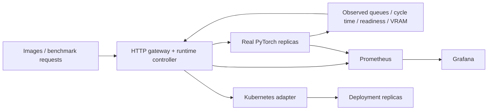

# JointSLA real-inference prototype

This is the first staged infrastructure prototype. It runs real pretrained
MobileNetV3-Large inference through Docker, routes requests using the existing
JointSLA score, exports real telemetry and displays it in Prometheus/Grafana.
An optional Kubernetes adapter applies bounded replica changes to one Deployment.
It is separate from the frozen simulation/paper evidence and produces no new
paper results or production-readiness claims.

## Clear boundaries

| Layer | Responsibility | Location |
|---|---|---|
| Simulator | Virtual queues, resource ledger, physical event model | Existing `dynamic_placement`, `hardware_grounded`, `hardware_pressure` |
| Frozen JointSLA | Scientific policy and experiment parameters | Existing `joint_routing`, `joint_sla_v2` |
| Experiments | Paired workload generation, trials, accounting, reports | Existing runners and `results` |
| Runtime decisions | Translate measured states into routing/warm targets | `prototype/controller.py` |
| Runtime service | Real model execution and bounded serial queue | `prototype/inference.py` |
| Runtime control | HTTP gateway, discovery, telemetry, cooldown | `prototype/gateway.py` |
| Actuation | Observe mode or namespace-scoped Kubernetes scale API | `prototype/adapters.py` |
| Real benchmark | Concurrent actual requests and client outcomes | `prototype/load.py` |

The prototype imports `joint_routing.router.choose` and
`joint_sla_v2.policy.required_warm` unchanged. It does **not** port the entire
simulator-specific v2 placement/controller state machine. There is one model
service with request tiers; there are no 20-service topology experiments here.
The first routing adapter uses measured cycle/queue statistics and assumes
zero inter-node network/resource-wait penalty in its score. Actual HTTP latency
is measured separately. It does not reproduce a multi-edge network model.



## Docker demo (first four stages)

Run from the repository root with Docker Desktop's Linux engine active:

```powershell
docker compose -f prototype/compose.yaml up -d --build --scale inference=2
```

The build downloads the pinned ImageNet MobileNetV3 weights into the image.
Both inference replicas run as a non-root user. CPU and memory limits are
explicit. The gateway waits for model readiness; it discovers Compose replicas
by DNS and performs real HTTP routing. Ports are bound to localhost.

- Gateway: http://127.0.0.1:8090/state
- Prometheus: http://127.0.0.1:9090
- Grafana: http://127.0.0.1:3000/d/jointsla-runtime

```powershell
.venv\Scripts\python.exe -m prototype.load --requests 100 --concurrency 8 --seed 1
docker compose -f prototype/compose.yaml up -d --scale inference=3
docker compose -f prototype/compose.yaml logs --tail 30 gateway inference
docker compose -f prototype/compose.yaml down
```

Compose uses **observe** mode: the controller computes and reports replica
targets, while routing is active. The scale command above is manual Docker
actuation. There is no Docker socket mount or hidden container-management API.
Kubernetes mode below enables actual autonomous scaling.

POST `/infer` accepts `tier` (`Gold`, `Silver`, `Bronze`), `deadline_ms`, and
either `image_base64` or an integer benchmark `seed`. Example:

```powershell
Invoke-RestMethod http://127.0.0.1:8090/infer -Method Post -ContentType application/json -Body '{"tier":"Gold","deadline_ms":200,"seed":1}'
```

`seed` creates a synthetic input tensor but executes the **real** neural network;
its predicted classes do not carry semantic meaning. Image input uses the
published model's preprocessing. Results explicitly report pretrained status.
Historical hardware calibration used locally initialized weights; its latency
numbers are not copied into the runtime service.

## Native Python alternative

```powershell
.venv\Scripts\python.exe -m pip install -r prototype/requirements-inference.txt
.venv\Scripts\python.exe -m prototype.inference --port 8080
```

In a second terminal:

```powershell
$env:INFERENCE_ENDPOINTS='http://127.0.0.1:8080'
.venv\Scripts\python.exe -m prototype.gateway
```

`MODEL=mobilenet` or `resnet50`, `DEVICE=cpu` or `cuda`, `PRETRAINED=true`
and `QUEUE_LIMIT=8` configure inference. The supplied Docker image is CPU-only.
Native CUDA requires the installed compatible PyTorch/CUDA environment; GPU
container/device-plugin deployment is a subsequent step. `PRETRAINED=false`
allows offline architecture tests, clearly marked untrained in responses.

## Kubernetes stages

The manifest and actuator have now been validated on a local kind cluster.
See [local setup and validation](kubernetes/README.md). A cluster remains
required for Kubernetes mode; Compose uses observe mode.
Use the dedicated local deployment command from the repository root:

```powershell
powershell -NoProfile -ExecutionPolicy Bypass -File prototype/kubernetes/deploy.ps1 -Validate
```

This creates/reuses the owned kind cluster, builds and loads pinned images,
provisions monitoring, waits for startup and runs real recovery checks. It uses
an isolated kubeconfig; the global context is never selected. The full audit and
operational boundaries are in [INFRASTRUCTURE_VALIDATION.md](../INFRASTRUCTURE_VALIDATION.md).

In Kubernetes mode the gateway lists ready, non-terminating inference pods and
routes directly to them. Every two seconds it computes a warm target (Gold
floor two, maximum four), using observed rates over the previous ten seconds,
queue depth and observed execution cycles. Startup allowance defaults to
`COLD_START_SECONDS=10`; this is a configurable assumption, not a measured
container-startup distribution. Scale-in/out uses a 30-second action cooldown,
Deployment desired replicas (including pending pods), and resource-version
concurrency control. Role permissions only allow listing pods in the prototype
namespace and reading/patching the `inference` Deployment's scale subresource.

CPU/memory placement is performed by the Kubernetes scheduler using requests
and limits; JointSLA does not yet place pods on individual edge nodes or schedule
GPU VRAM. Kubernetes handles pod replacement and readiness failures; the gateway
withdraws stale/unready endpoints and does not retry failed inference requests.
SIGTERM withdraws readiness and drains admitted requests for up to 60 seconds.
Do not run an HPA or second controller against this Deployment concurrently.
Prometheus/Grafana are provisioned separately for Compose and Kubernetes. The
Kubernetes stack persists data across pod restarts and exposes infrastructure alerts.

## Metrics and evidence

`/metrics` exposes latency histograms, offered/outcome/SLA-failure counters by
tier, waiting queues, observed ready/desired replicas, actual allocated CUDA
VRAM bytes and applied/observed/failed control actions. CPU mode reports zero
CUDA VRAM. A rejected or failed request counts as an SLA failure, preventing
an apparent improvement by dropping traffic.

The Grafana rate uses **finalized outcomes** in a rolling window; pending work
is excluded until finalized. The benchmark CSV accounts for every offered
request after all client calls finish, including timeouts and rejections.
Client wall latency includes HTTP/network overhead; gateway latency covers
gateway admission/forwarding; backend latency covers backend queue/execution.
They are separate measurement boundaries. Do not add them together.

Outputs stay under ignored `prototype/.cache/`. Real timings are not deterministic
despite deterministic offered inputs; paired multi-run experimental validation
is still required. No claim about <15% breaches, paper-level superiority or
production deployment follows from the smoke demo.

Next controlled work: startup calibration, multiple services with per-service tiers/budgets, GPU capacity
admission and explicit placement, then paired real-workload measurements.

## Implementation references

- [TorchVision MobileNetV3 weights/transforms](https://docs.pytorch.org/vision/stable/models/generated/torchvision.models.mobilenet_v3_large.html)
- [Compose health-based startup](https://docs.docker.com/compose/how-tos/startup-order)
- [Prometheus exposition format](https://prometheus.io/docs/instrumenting/exposition_formats/)
- [Grafana provisioning](https://grafana.com/docs/grafana/latest/administration/provisioning/)
- [Official Kubernetes Python client](https://github.com/kubernetes-client/python)
