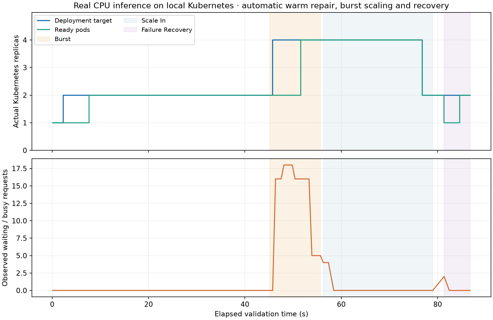

# Kubernetes integration observations

Validated locally on 8 October 2026 (Europe/Athens). This is a functional
integration test on one physical host and one kind node, using real pretrained
CPU MobileNet inference. It is not a paired paper experiment or production benchmark.

The controller performed **1 → 2 → 4 → 2** replica reconciliation. New ready
pods served traffic. After one pod was deleted, Kubernetes replaced it and
the gateway excluded the failed endpoint without retrying the failed request.

| Phase | Offered | Completed | SLA failures (all offered) | Failed/rejected | Mean completed latency |
|---|---:|---:|---:|---:|---:|
| baseline | 60 | 60 | 0.00% | 0.00% | 78.7 ms |
| burst | 1280 | 943 | 38.83% | 26.33% | 168.8 ms |
| failure | 80 | 79 | 1.25% | 1.25% | 53.6 ms |

Burst traffic was paced at 120 requests/s, 1280 requests total,
with client concurrency bounded at 32. Gold/Silver/Bronze deadlines were
200/400/800 ms; the service uses FIFO admission, not tier-priority queues.
The burst still violated the <15% SLA objective; successful actuation is
not evidence of SLA superiority. Rejected requests remain SLA failures.
Completed latency excludes failed/rejected calls to avoid a deceptively low mean.

Compact sources: [summary](evidence/summary.csv), [timeline](evidence/replica_timeline.csv),
[actuation verification](evidence/verification.json). Full per-request outcomes,
pod snapshots and logs remain locally in `prototype\.cache\kubernetes_20261008T151215`.

The earlier unpaced stress test exposed repeated routing to a failed pod.
That run is retained locally. Endpoint withdrawal was fixed, tested, and
validated again; the revised burst workload means these runs are not a paired
performance comparison. Frozen scientific sources/results are unchanged.
