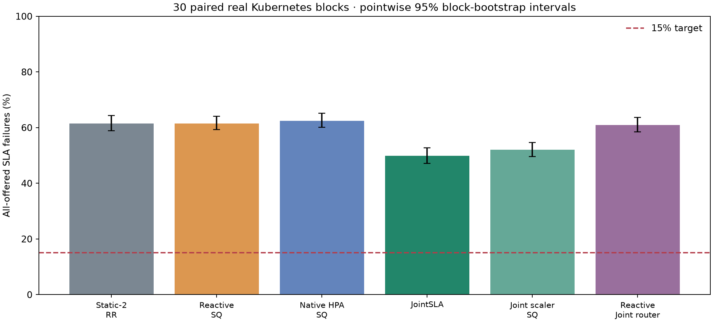
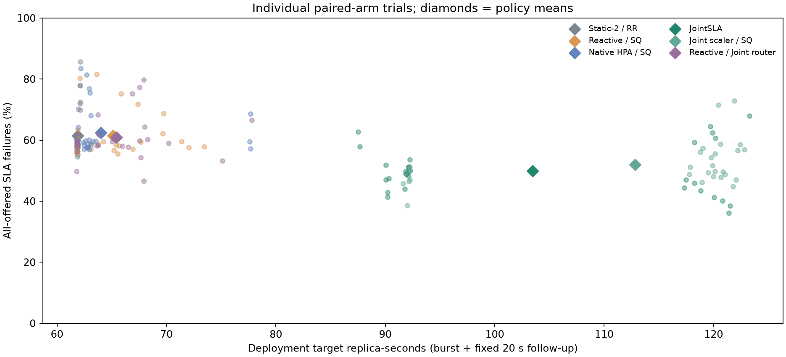
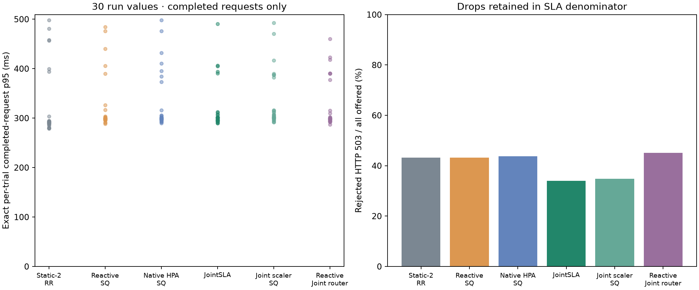

# JointSLA: matched real Kubernetes comparison v2

Completed: 30 paired blocks, six registered treatments, 180 trials, 230,400 verified offered request outcomes. Pilot data and historical 38.83%/47.27% bursts are excluded.

## Findings

| Policy | SLA failures, mean ± std (%) | Completed p95, mean ± std (ms) | HTTP 503 (%) | Target replica-seconds |
|---|---:|---:|---:|---:|
| Static-2 / RR | 61.50 ± 7.85 | 320.99 ± 67.12 | 43.22 ± 8.03 | 61.90 ± 0.10 |
| Reactive / SQ | 61.43 ± 6.94 | 322.85 ± 55.60 | 43.16 ± 7.48 | 65.12 ± 3.39 |
| Native HPA / SQ | 62.39 ± 7.37 | 328.26 ± 58.23 | 43.76 ± 7.92 | 64.03 ± 4.65 |
| JointSLA | 49.89 ± 8.12 | 318.63 ± 47.74 | 33.98 ± 7.75 | 103.45 ± 14.60 |
| Joint scaler / SQ | 51.99 ± 7.14 | 329.54 ± 54.15 | 34.87 ± 6.74 | 112.84 ± 12.79 |
| Reactive / Joint router | 60.95 ± 7.27 | 323.45 ± 49.01 | 45.07 ± 7.34 | 65.44 ± 4.01 |

Raw observed trial wall time averaged 111.88 s; raw preparation averaged 81.18 s. These include a user-requested 91.65-minute pause in block 0 / joint_sq before its burst. Subtracting that recorded pause gives approximately 81.33 s observed active wall time and 50.63 s preparation per trial. Raw CSV timings are preserved. These values are not a paired end-to-end speed comparison with the aborted v1. See the [pause disclosure](USER_PAUSE_NOTE.md); the paused arm is an exploratory mechanism treatment.

Latency is conditional on completion. Every rejection remains in the all-offered SLA denominator. Resource-seconds cover burst start to last response plus a fixed 20-second follow-up.

| Paired contrast | SLA difference (percentage points) | 95% paired block-bootstrap interval | Holm p (three core contrasts) |
|---|---:|---:|---:|
| joint minus reactive | -11.54 | [-13.98, -9.06] | 3.7253e-08 |
| joint minus static | -11.61 | [-13.79, -9.33] | 2.794e-08 |
| joint minus hpa | -12.50 | [-15.18, -9.99] | 2.3505e-06 |
| joint minus joint_sq | -2.10 | [-4.84, 0.73] | exploratory |
| joint minus reactive_joint | -11.05 | [-13.73, -8.30] | exploratory |

The registered primary contrast supports lower all-offered SLA failures for JointSLA than reactive under this burst regime.

The <15% mean all-offered SLA target is not met in this registered regime.

## Failure attribution

| Policy | Tier | Failure category | Requests |
|---|---|---|---:|
| Native HPA / SQ | Bronze | queue_full | 5,665 |
| Native HPA / SQ | Gold | completed_late | 6,851 |
| Native HPA / SQ | Gold | queue_full | 5,528 |
| Native HPA / SQ | Silver | completed_late | 304 |
| Native HPA / SQ | Silver | queue_full | 5,610 |
| JointSLA | Bronze | queue_full | 4,353 |
| JointSLA | Gold | completed_late | 5,969 |
| JointSLA | Gold | queue_full | 4,232 |
| JointSLA | Silver | completed_late | 139 |
| JointSLA | Silver | queue_full | 4,465 |
| Joint scaler / SQ | Bronze | queue_full | 4,405 |
| Joint scaler / SQ | Gold | completed_late | 6,395 |
| Joint scaler / SQ | Gold | queue_full | 4,389 |
| Joint scaler / SQ | Silver | completed_late | 179 |
| Joint scaler / SQ | Silver | queue_full | 4,597 |
| Reactive / SQ | Bronze | queue_full | 5,465 |
| Reactive / SQ | Gold | completed_late | 6,816 |
| Reactive / SQ | Gold | queue_full | 5,545 |
| Reactive / SQ | Silver | completed_late | 198 |
| Reactive / SQ | Silver | queue_full | 5,565 |
| Reactive / Joint router | Bronze | queue_full | 6,063 |
| Reactive / Joint router | Gold | completed_late | 5,916 |
| Reactive / Joint router | Gold | queue_full | 5,493 |
| Reactive / Joint router | Silver | completed_late | 181 |
| Reactive / Joint router | Silver | queue_full | 5,750 |
| Static-2 / RR | Bronze | queue_full | 5,656 |
| Static-2 / RR | Gold | completed_late | 6,737 |
| Static-2 / RR | Gold | queue_full | 5,614 |
| Static-2 / RR | Silver | completed_late | 284 |
| Static-2 / RR | Silver | queue_full | 5,326 |

Error reasons identify explicit rejection branches. Queue time and execution time are observed for completed requests; rejected requests have no fabricated compute duration. Pod readiness and cgroup throttling are measured concurrent exposures, not mutually exclusive causal labels.

## Contribution and limits

The experiment tests the unchanged integrated JointSLA controller on real pretrained CPU inference against fixed, CPU-reactive and native Kubernetes HPA baselines, with paired workload tapes, balanced order and explicit drops. Two registered exploratory rule substitutions test scaling/routing contributions. Feedback means those substitutions do not preserve identical realized replica trajectories.

This adds empirical evidence and reproducible infrastructure. It does not establish that SLA-aware routing, warm replicas or autoscaling are new ideas. Literature novelty needs a verifiable prior-work comparison of the exact joint mechanism; unsupported citations remain excluded.

The local operational prototype is complete within its audited scope. Scientific generalization remains limited: one physical host, one virtual node, one CPU model, synthetic tensors, short ~10.7-second burst, background host activity, sampled/cached telemetry, and 30 blocks on the same deployment. Native HPA retains asynchronous metrics and default stabilization; the sustained pilot verifies actuation but is not a repeated sustained-workload comparison.

Historical 38.83% and 47.27% are all-offered failure rates from separate 1,280-request bursts at different infrastructure revisions/start states. Neither is a baseline-relative improvement. The new benchmark also adds common instrumentation and identical preconditioning, so its levels must not be pooled with those historical runs.

## Reproduction and evidence

See the frozen [protocol](../../RESEARCH_EVALUATION_PROTOCOL.md) and [manifest](manifest.json). Raw immutable CSV outcomes, workload tapes, pod/HPA timelines and logs reside in `prototype/.cache/kubernetes_comparison_v2/`; all 230,400 outcomes were independently reconstructed. Curated [runs](runs.csv), [summary](summary.csv), [paired contrasts](paired_comparisons.csv), [failure categories](failure_categories.csv), and [verification/hashes](analysis.json) are exported alongside this report.

```powershell
.venv/Scripts/python.exe -m prototype.benchmark.experiment --run
.venv/Scripts/python.exe -m prototype.benchmark.analyze
```






